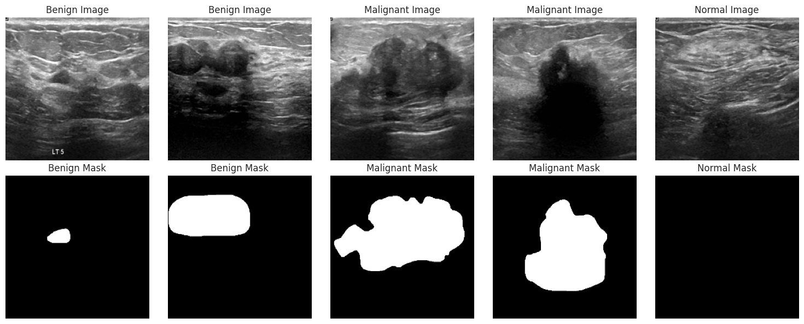
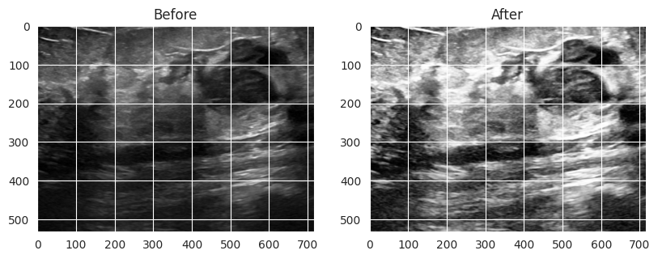
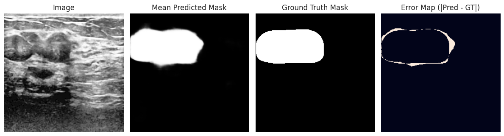

# BUSI-CAD
### Breast Ultrasound Segmentation and Classification with Deep Learning

BUSI-CAD investigates two complementary tasks in breast ultrasound analysis: delineating lesions through pixel-level segmentation and classifying images as **benign, malignant, or normal**.

The project brings together a custom **U-Net** segmentation model and an **ImageNet-pretrained ResNet-50** classifier. It covers image preparation, model development, class-weighted training, quantitative evaluation, and exploratory visualization of model predictions.

**Highlights:** 84.10% peak classification validation accuracy on 195 images, with a macro F1 score of 0.8296 at the same epoch.

[Explore the notebook](notebooks/BUSI_CAD.ipynb)
[Read the technical report](reports/BUSI_CAD_Report.pdf)]

## Motivation

Segmentation and classification address different aspects of ultrasound image analysis. Segmentation examines *where* a lesion appears, while classification estimates *which category* an image belongs to.

This project explores both tasks through separate modeling workflows. Its focus is on implementing and examining the full experimental process—from preparing image–mask pairs to evaluating learned predictions—within a compact medical imaging dataset.

## Technical contributions

- **Custom segmentation architecture:** implemented a U-Net with encoder–decoder skip connections, batch normalization, and dropout.
- **Overlap-aware optimization:** combined binary cross-entropy and soft Dice loss to incorporate both pixel-level classification and lesion overlap.
- **Transfer learning:** adapted ResNet-50 with a task-specific classification head and selective fine-tuning of its final backbone layers.
- **Data preparation:** integrated image enhancement for segmentation and flip augmentation for classification.
- **Class-weighted training:** combined frequency-based weights with additional class-specific weighting in the classification objective.
- **Evaluation and analysis:** tracked macro precision, recall, and F1 alongside accuracy, saved the best classification checkpoint, and implemented exploratory Grad-CAM and stochastic segmentation analyses.

## Dataset

The project uses the [Breast Ultrasound Images (BUSI) dataset](https://www.kaggle.com/datasets/aryashah2k/breast-ultrasound-images-dataset), containing **780 images** across three categories.

| Class | Images |
|---|---:|
| Benign | 437 |
| Malignant | 210 |
| Normal | 133 |
| **Total** | **780** |

*Examples of benign, malignant, and normal ultrasound images with their corresponding annotation masks.*

Ground-truth masks support the segmentation workflow, while image-level labels support three-class classification.

The experiments use separate image-level splits:

| Task | Training share | Validation share |
|---|---:|---:|
| Segmentation | 80% | 20% |
| Classification | 75% | 25% |

Classification augmentation is applied after splitting, keeping validation images outside the augmentation process. The dataset is downloaded separately and is not included in this repository.

## Methods

### Lesion segmentation

The segmentation workflow applies bilateral filtering, histogram equalization, and contrast-limited adaptive histogram equalization (CLAHE). Enhanced grayscale images are replicated across three channels and resized to **256 × 256 pixels**.

*An example before and after bilateral filtering, histogram equalization, and CLAHE, illustrating the contrast transformation used in segmentation preprocessing.*

A U-Net predicts a single-channel lesion probability map. Its four encoder–decoder stages combine contextual features with spatial information carried through skip connections.

The training objective equally weights binary cross-entropy and soft Dice loss:

**Segmentation loss = 0.5 × binary cross-entropy + 0.5 × soft Dice loss**

Training runs for 50 epochs with Adam. Loss, pixel accuracy, and soft Dice are tracked on the training and validation subsets.

### Image classification

The classifier uses **ResNet-50 initialized with ImageNet weights**, followed by global max pooling and a task-specific head comprising a 512-unit dense layer, batch normalization, dropout, and a three-class softmax output.

The final 12 backbone layers are unfrozen for fine-tuning. Horizontal and vertical flip augmentation produces **1,170 training samples from 585 source images**.

| Training setting | Configuration |
|---|---|
| Input size | 224 × 224 |
| Optimizer | Adam |
| Learning rate | 0.0005 |
| Batch size | 32 |
| Epochs | 50 |
| Objective | Class-weighted categorical cross-entropy |
| Checkpoint selection | Highest validation accuracy |

A custom callback records macro precision, macro recall, and macro F1 at each epoch. These metrics give each class equal weight and complement overall accuracy.

### Exploratory prediction analysis

The notebook includes two approaches for inspecting model behavior:

- **Stochastic segmentation sampling:** repeated forward passes calculate mean probability maps and pixel-wise prediction variance. Saved examples display mean predictions alongside ground-truth masks and prediction errors.
- **Grad-CAM:** a gradient-based visualization uses ResNet-50’s final convolutional block to generate a class-specific heatmap and image overlay.

These analyses provide exploratory views of individual predictions. Implementation context accompanies the examples in the notebook.

## Results

### Classification

The highest validation accuracy was recorded at **epoch 28** on **195 validation images**.

| Metric | Value |
|---|---:|
| **Validation accuracy** | **84.10%** |
| Macro precision | 0.8309 |
| Macro recall | 0.8379 |
| **Macro F1** | **0.8296** |

All classification metrics above refer to the same epoch.

### Segmentation

The final-epoch U-Net evaluation recorded:

| Metric | Value |
|---|---:|
| **Validation soft Dice** | **0.6817** |
| Validation pixel accuracy | 96.22% |
| Validation combined loss | 0.2465 |

Soft Dice measures overlap using continuous prediction probabilities aggregated within evaluation batches. Pixel accuracy includes background pixels and is reported as a complementary measure.

### Segmentation example

*Illustrative example from the stochastic segmentation analysis. From left to right: input image, mean predicted probability map across 20 forward passes, ground-truth mask, and absolute error after thresholding the mean prediction. This example is drawn from the full dataset and is shown for qualitative inspection.*

Results are taken from the notebook’s saved experimental outputs. They represent internal validation performance; the classification validation split also serves for checkpoint selection.

## Exploring the project

The [notebook](notebooks/BUSI_CAD.ipynb) contains the implementation, training histories, and saved visualizations. It can be read without downloading the dataset or rerunning training.

The original execution workflow uses **Google Colab** and the Kaggle API. To run it:

1. Open the notebook in a compatible Python notebook environment.
2. Obtain the dataset through the linked Kaggle source.
3. If using the included Colab download cell, provide your own `kaggle.json` credentials.
4. Confirm that `Dataset_BUSI_with_GT` contains the `benign`, `malignant`, and `normal` directories.
5. Run the cells in order; a GPU is recommended for training.

Kaggle credentials should remain outside the repository. The current edition preserves historical outputs rather than presenting a newly reproduced run.

## Repository structure

| Path | Contents |
|---|---|
| [`notebooks/BUSI_CAD.ipynb`](notebooks/BUSI_CAD.ipynb) | Modeling workflows, evaluation, and saved outputs |
| `README.md` | Project overview and results |
| `.gitignore` | Exclusions for temporary Python files |
| `assets/` | Selected notebook figures used in this README |

## Tools

**Python · TensorFlow/Keras · OpenCV · NumPy · scikit-learn · Matplotlib · Pillow · Google Colab**

## Ongoing development

Planned work includes refining preprocessing consistency, extending per-class and per-image evaluation, comparing modeling choices through controlled experiments, and developing the stochastic prediction analysis further.

The current repository provides a documented baseline for these extensions.

## Project background

Originally developed in August 2025 as a final project for the Data Science course at Shahid Beheshti University, in collaboration with Houtan Tahanha. This repository presents an updated edition with revised organization and documentation.
